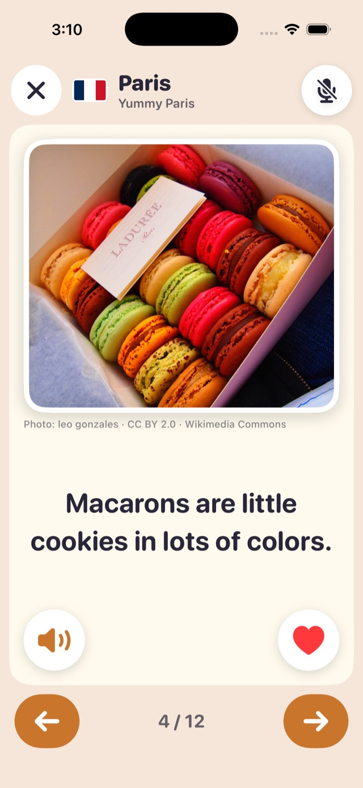
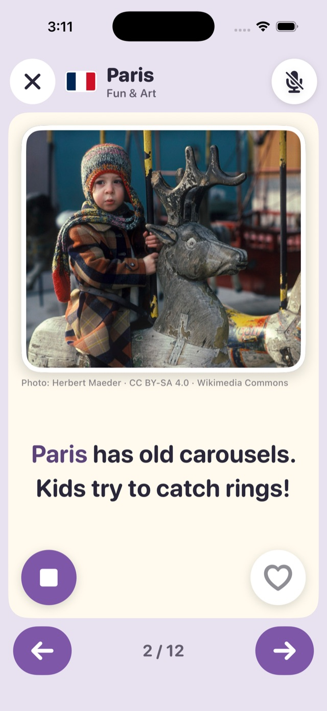
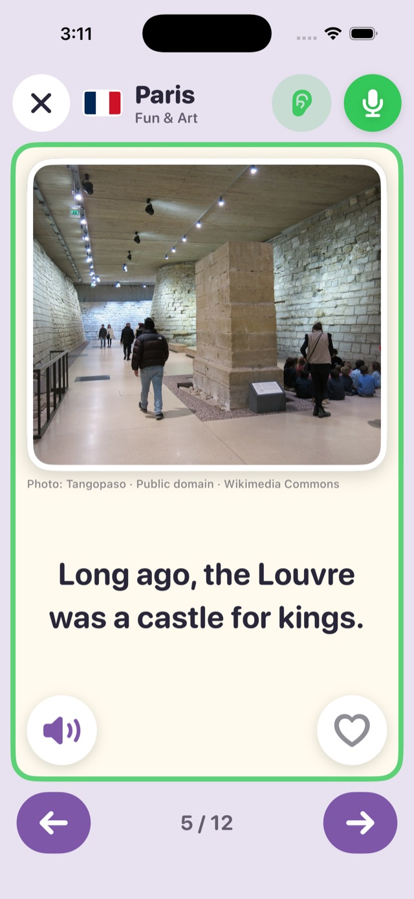

# Little Explorer

A picture-book app for iPhone and iPad that helps a 6-year-old discover cities and get excited about travel.
Each page has a real photo, a short sentence he can read by himself, a heart button for pages he loves,
and a speaker button that reads the sentence aloud. An optional voice buddy, **Milo**, listens patiently
while he reads and answers his questions about the book.

| Shelf | Yummy Paris + heart | Read aloud | Voice mode |
|---|---|---|---|
|  |  |  |  |

iPad versions are in [`docs/screenshots`](docs/screenshots).

## Books

The first screen is a shelf with every book, grouped by city. Tap a cover to open it.

| City | Book (`id`) | Theme |
|---|---|---|
| Paris | Famous Places (`paris`) | The Seine, Eiffel Tower (repainting, sparkles), Louvre and Mona Lisa, Notre-Dame, Arc de Triomphe, toy sailboats |
| Paris | Yummy Paris (`paris-food`) | Baguettes, pain au chocolat, macarons, crêpes, cheese, a market, a café, ice cream, snails, a picnic |
| Paris | Fun & Art (`paris-fun`) | Carousels, puppet shows, a Seine boat, the Louvre's old castle, Orsay, Monet's water lilies, Montmartre painters and funicular, The Thinker, the river beach |
| Paris | Notre-Dame (`paris-notre-dame`) | The island in the Seine, gargoyle rain spouts, chimeras, rose windows, the Emmanuel bell, the kind bell ringer, the 2019 fire and its firefighters, the rebuilders, the golden rooster on the spire, the 2024 reopening, Point Zéro |
| London | London (`london`) | The Thames, Big Ben, Tower Bridge, buses, ravens, guards, London Eye, the Tube, the museum whale, fish and chips |
| London | Big Ben (`london-big-ben`) | Big Ben the bell vs the Elizabeth Tower, who it's named after, the giant clock faces and minute hands, the bongs, the radio chimes, pennies on the pendulum, the Ayrton Light, 334 steps, Westminster Bridge |
| Barcelona | Barcelona (`barcelona`) | Beach, Sagrada Família, Casa Batlló, Park Güell's dragon, churros, human towers, football, the magic fountain |

Books are JSON files in [`LittleExplorer/Resources/Books`](LittleExplorer/Resources/Books) with 10–14 pages each.
Every page has a 4–12 word sentence, hidden `about` notes for Milo, and a photo. The shelf order is `BookLibrary.order`.
A city with several books shows them under one city heading; `theme` is the title on the cover.

Hearts are stored on the device as `<book id>/<page id>`, so each themed book keeps its own hearts.
Grown-ups can see the loved pages for every book behind the parent gate (lock button).

### Photos

All photos come from Wikimedia Commons under free licenses (public domain, CC0, CC BY, CC BY-SA).
The credit (author · license · Commons) is shown under each photo. No photo is used twice.
[`scripts/fetch_photos.py`](scripts/fetch_photos.py) checks each license through the Commons API and bundles a resized copy:

```sh
python3 scripts/fetch_photos.py --only paris-food            # one book
python3 scripts/fetch_photos.py --only paris-fun/carousel --force   # re-fetch one page
```

Pin a specific file by setting the page's `photo.commonsTitle`.

## Read aloud

The speaker button (bottom-left of every page) reads the sentence in a natural voice, the same OpenAI voice as Milo
(`gpt-4o-mini-tts`, "coral"), styled like a grown-up reading a picture book to a 6-year-old: warm, clear and a little slow.
The clips are made ahead of time and bundled (about 2 MB of AAC for all 64 pages), so reading aloud works offline
and the app never holds an API key. Each word is highlighted as it's spoken. Tap again to stop. Speech also stops when
the page turns or the book closes. When voice mode is on, the microphone is muted while the app reads, so Milo doesn't
mistake the app's voice for the child.

[`scripts/generate_narration.py`](scripts/generate_narration.py) makes the clips. It reads each sentence with
`gpt-4o-mini-tts` and gets word timings from `whisper-1`. It tightens those timings to the real pauses in the audio,
retries if the transcript doesn't match the sentence, and writes `LittleExplorer/Resources/Narration/`. After editing a
sentence, rerun it (it only regenerates pages that changed). It needs `OPENAI_API_KEY` (or an env file, see below) and macOS `afconvert`:

```sh
python3 scripts/generate_narration.py                  # new or changed pages only
python3 scripts/generate_narration.py --only paris/eiffel --force
```

If a page has no clip for its current sentence, the app falls back to the best on-device system voice
(`AVSpeechSynthesizer`, slower rate, same word highlighting).

## Voice buddy (Milo)

Tap **Talk to Milo** in a book to start voice mode. It stays on across page turns until it's turned off.
On every page turn the app sends the current page (book, page, sentence) to the agent.
The agent lives in [`server/`](server) (LiveKit Agents + LangGraph; its voice stack is in `server/src/little_explorer_agent/voice/`):

- **Reading:** while he reads the page aloud, Milo stays quiet (the reading gate → LISTEN), even if he reads slowly or softly, then praises him.
- **Noise:** background voices are cancelled, and an LLM relevance gate ignores noise, other people's conversations and off-topic talk.
- **Patience:** Milo waits through his pauses and answers briefly and warmly, ending with an open question that invites a longer reply.

Milo's settings start with `PIP_`. Milo has two voice engines. Pick one with `PIP_MODE` in the env file and restart the agent; the app doesn't change.

- `PIP_MODE=pipeline` (default): streaming transcription (`gpt-realtime-whisper`) → reply (LangGraph) → `gpt-4o-mini-tts`.
  A local end-of-turn model decides when he has finished (0.5 s when his words sound done, up to 4 s mid-sentence).
  Local Silero VAD stops Milo after 0.3 s of his speech and resumes if it was only a noise. The reading and noise
  checks are instant; the LLM topic check runs alongside the reply instead of before it.
- `PIP_MODE=realtime`: one OpenAI Realtime speech-to-speech model (`gpt-realtime`, voice `coral`) hears him and talks
  back. It uses `semantic_vad` with low eagerness, so slow reading isn't cut off. The page is in its instructions
  and is updated on every page turn. The instructions tell it to stay quiet (a `stay_quiet` tool) while he reads and
  when grown-ups talk. A guard checks each transcript afterwards and cuts off a reply to reading or adult talk. It
  never delays a reply. Realtime costs much more per minute than the pipeline.

The e2e harness can try either engine without restarting the agent: `tools/e2e_smoke.py --mode realtime`.
It reports the reply latency and how fast Milo stops when talked over.

No audio is stored. The app never holds LiveKit secrets. A small token server mints room tokens that dispatch the agent automatically.

```sh
cd server
cp .env.example .env        # fill in LIVEKIT_* and OPENAI_API_KEY (never commit .env)
uv sync
uv run python -m little_explorer_agent.token_server   # http://127.0.0.1:8787
uv run python -m little_explorer_agent.agent dev      # the Milo worker
uv run pytest -q
uv run python tools/e2e_smoke.py                       # live end-to-end check (no audio saved)
```

Secrets are loaded from the first of: the path in `LITTLE_EXPLORER_ENV`, `server/.env`, or
`~/.config/little-explorer/.env` (a per-user copy, `chmod 600`, that survives deleting the checkout). The token
server, the agent, `tools/e2e_smoke.py` and `scripts/generate_narration.py` all use this order. Variables already
set in the shell win. Admin-only keys in the same file (`OPENAI_ADMIN_KEY`, `RENDER_API_KEY`) are never loaded
by the server, so they can't be logged or passed on.

### What a session costs

When a Milo session ends (he closes the book, the app drops off, or the worker stops), the agent appends one row to
`~/.config/little-explorer/usage.csv` (mode 600; `PIP_USAGE_FILE` moves it): start time, length, engine, model,
book, pages visited, number of model responses, input/output tokens split into text and audio, cached tokens,
input-transcription tokens, and an estimated price. It never holds transcripts or audio. Prices are OpenAI's list
prices per 1M tokens, kept in `usage.py` with the source link; override one with e.g.
`PIP_PRICE_GPT_REALTIME_AUDIO_OUT=64`. A worker that is killed outright (`kill -9`) can't write its rows.

```sh
uv run python tools/usage_report.py   # total minutes, $, $/minute, $/session, per day and per model
```

### Naps and daily limits per device

**Naps.** When neither he nor Milo has said anything for 20 seconds (`PIP_IDLE_TIMEOUT_S`, `0` = never), Milo ends
the session. The app switches the mic off and shows "Milo is taking a nap — tap to talk again". Reading aloud
counts as talking. Tapping **Talk to Milo** starts a fresh session.

**Devices.** The app sends a device id with every token request: its vendor id, saved in the Keychain so it
survives a reinstall, plus the device name and model. The Grown-ups corner shows the id. The token server keeps
each device's status and Milo minutes per day:

| Status | Daily Milo time | When the time is used up |
|---|---|---|
| unknown (any new device) | 10 min (`PIP_LIMIT_UNKNOWN_MIN`) | blocked automatically |
| approved | 60 min (`PIP_LIMIT_APPROVED_MIN`) | rests until tomorrow |
| blocked | none | until you unblock it |

Days run midnight to midnight in `PIP_TIMEZONE` (default `America/Los_Angeles`). A device that is blocked or
out of time gets no token, and the app shows "Milo needs a rest today. Let's talk again tomorrow!". The token
carries the time left, so a session that reaches the limit ends with a short goodbye from Milo. When a session
ends, the agent reports its length and estimated cost to the token server (`POST /usage`, with `PIP_REPORT_KEY`),
which stores it. Usage is stored per conversation, never transcripts or audio.

Storage is Postgres when `DATABASE_URL` is set (production uses a free [Neon](https://neon.tech) database:
Render's free disk is wiped on every deploy and restart, and Neon keeps the data, needs no server and costs
nothing at this size). Without it, a local SQLite file is used (`PIP_DEVICES_DB`, default
`~/.config/little-explorer/devices.sqlite3`). If the database can't be reached, tokens are still given out with
the unknown-device limit.

Check usage and manage devices with `tools/devices.py`. It calls the server's `/admin` endpoints with
`PIP_ADMIN_KEY` from your env file (`--direct` uses `DATABASE_URL` instead). The admin key is never in the app.

```sh
uv run python tools/devices.py                      # devices: status, today, last 7 days, total minutes and $
uv run python tools/devices.py usage --days 14      # minutes and $ per device per day
uv run python tools/devices.py approve <id> --label "Leo's iPad"   # by id, or by name/label if unique
uv run python tools/devices.py block <id or label>  # also: unblock, limit <ref> 30, limit <ref> default, rename
```

Approve your own devices after each has used Milo once (it appears in the list as unknown). iOS reports every
iPad as just "iPad", so use the id shown in the Grown-ups corner (it has a copy button) and give it a label.

The app uses the deployed server (`PIP_SERVER_URL` in `Config/Pip.xcconfig`). To try a local token server from a
device, set its address in the Grown-ups corner (e.g. `http://<your-mac>.local:8787`).

### Deploy

Two free-tier pieces. The app only talks to the first; LiveKit dispatches the second.

| Piece | Where | What it serves |
|---|---|---|
| Token and book server (`server/Dockerfile.web`) | Render web service `little-explorer-pip` (free plan), https://little-explorer-pip.onrender.com | `POST /token` (needs `Authorization: Bearer $PIP_ACCESS_KEY`), `/content/…` (books, photos, narration), `/healthz` |
| Milo agent (`server/Dockerfile`) | LiveKit Cloud agent, `server/livekit.toml` | joins each room the token server creates |

- **Render** builds from the repo root and redeploys on every push to its branch. Its env vars are
  `LIVEKIT_URL`, `LIVEKIT_API_KEY`, `LIVEKIT_API_SECRET`, `PIP_ACCESS_KEY`, `KEEPALIVE_SECONDS`, `DATABASE_URL`,
  `PIP_ADMIN_KEY` and `PIP_REPORT_KEY`, set in the Render dashboard, not in git. A free service sleeps after 15 idle minutes, so with `KEEPALIVE_SECONDS` set the
  server pings its own `/healthz` to stay awake (one always-on service fits in the free 750 hours a month). If it
  does fall asleep (e.g. after a redeploy fails), the first token takes about a minute.
- **Agent:** `scripts/deploy_agent.sh` reads the env file, uploads `OPENAI_API_KEY` and the `PIP_*` settings as
  LiveKit secrets, and creates the agent (first run, region `$LK_AGENT_REGION`, default `us-east`) or deploys a
  new version. Set `PIP_CONTENT_URL=https://little-explorer-pip.onrender.com/content` so Milo reads the same
  books as the app. Set `PIP_SERVER_URL=https://little-explorer-pip.onrender.com` and the same `PIP_REPORT_KEY`
  as Render so Milo reports each device's minutes. Stop any local `agent dev` worker afterwards; it would compete for the same rooms.
  `lk agent status .` and `lk agent logs .` (from `server/`, with `LIVEKIT_*` in the environment) show it.
- **Check it:** `TOKEN_URL=https://little-explorer-pip.onrender.com/token uv run python tools/e2e_smoke.py --mode realtime --trials 1`.

### Update books without an app update

The server publishes `content/manifest.json`, which lists every book, photo and narration clip with its SHA-256.
On launch (and when it comes back to the foreground) the app compares it with its copy, downloads only the changed
files, checks each hash, and switches to the new set in one step. If anything fails it keeps what it has; the
books bundled in the app are the last fallback. Milo re-reads the books from the same server at most once a minute.

1. Edit `LittleExplorer/Resources/Books/*.json` (or `library.json` for the shelf), add photos to
   `Resources/Photos` and run `scripts/generate_narration.py` for new sentences.
2. Push to the branch Render deploys. Render rebuilds; the next app launch picks the changes up.

A new book must still use the existing page format; a format change needs an app update.

## Build and test the app

Requires Xcode 26 (iOS 26 SDK). The project is checked in; no xcodegen needed.

```sh
xcodebuild -project LittleExplorer.xcodeproj -scheme LittleExplorer \
  -destination 'platform=iOS Simulator,name=iPhone 17 Pro' test
scripts/screenshots.sh <iphone-udid> <ipad-udid>   # regenerates docs/screenshots
```

DEBUG builds accept launch arguments for screenshots: `-demoBook paris-food -demoPage 4 -demoLove`,
`-demoVoice listening|live`, `-demoRead`.

### Install on an iPhone or iPad (TestFlight)

The app is "Little Explorer Kids" in App Store Connect, and every build goes to the internal TestFlight group
"Family". Install **TestFlight** from the App Store on the device, sign in with the developer Apple ID, accept the
invite, and turn on Automatic Updates for the app. New builds then install themselves; no cable is needed.

```sh
scripts/testflight.sh   # archive, sign for App Store distribution, upload, and wait for Apple's processing
```

It needs an App Store Connect API key (Admin role): the `.p8` in `~/.appstoreconnect/private_keys/`, and
`ASC_KEY_ID` and `ASC_ISSUER_ID` in the environment or `~/.config/little-explorer/asc.env`. The build number is
the date and time. `PIP_ACCESS_KEY` from `Config/Local.xcconfig` is built in, so keep TestFlight to internal
testers. Book changes don't need a new build (see "Update books without an app update").

> **Simulator note:** the iOS 26.2/26.3 simulators draw every emoji as a "?" box. Real devices are fine.
>
> **Voice in the simulator:** the simulator has no Apple echo cancellation, so the app uses WebRTC's
> software echo cancellation there. Milo can still hear itself through loud Mac speakers; headphones
> give the cleanest test.
> The app avoids emoji in its UI: flags are bundled images, and buttons use SF Symbols.
