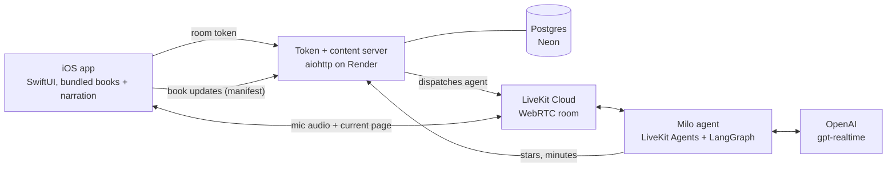

# Little Explorer

**Big world, little readers.** A picture-book app for iPhone and iPad, made for kids ages 4–8, with an AI voice
buddy who listens while they read and talks with them about the places in the book.

| Shelf | Yummy Paris | Read aloud | Voice mode |
|---|---|---|---|
|  |  |  |  |

iPad versions are in [`docs/screenshots`](docs/screenshots).

## What it does for your kid

- **Opens up the world.** 39 books and 502 pages about Paris, London, Barcelona, Beijing, Shanghai, Chengdu,
  Longyan, Hawaii, Lake Tahoe and Israel, plus a Travel shelf on flying, packing, passports, hotels and jet lag.
  (A new family starts with 12 of them.) Every page is a real photo, not a cartoon.
- **Builds reading confidence.** Each page has one short sentence (4–12 words) that early readers can tackle on their
  own. One tap reads it aloud in a warm, natural voice and highlights each word as it's spoken, offline. Names are
  said the local way, so kids hear "Gaudí", "xiaolongbao" and "Waikīkī" said right.
- **Gets them talking, not just tapping.** Milo stays quiet while your kid reads the page aloud, then cheers them
  on. Milo answers their questions about the book and asks easy, open follow-ups. When they answer in two words
  ("the boat"), Milo hands them a sentence to finish ("You could say, I would ride the boat because...").
- **Rewards real effort.** Thoughtful answers earn stars, cities earn Passport stamps, and a star calendar fills up.
  Badges for pages and books read, read-aloud, reading days in a row, Milo stars and places visited are grouped in
  the Passport, and the server can change them without an app update. A grown-up can trade stars for coins.
- **Safe by design.** No ads, no in-app purchases, no tracking. The only personal information is a grown-up's email:
  nothing about your child is asked for. Milo is told to keep things kind and kid-appropriate and never to ask for
  personal details. Milo stays off until a grown-up allows it (asked at sign-in and behind the grown-up check, and can be
  turned off any time in the Grown-ups corner); even then the mic stays off until someone taps **Talk to Milo**,
  the app doesn't record or keep the audio, and Milo has a daily time limit. See [privacy and terms](PRIVACY.md).

## How it works



The app never holds an OpenAI or LiveKit secret. It asks the server for a short-lived room token, the token
dispatches the Milo agent into a fresh LiveKit room, and every page turn is sent to the agent so Milo always knows
which page is open. Books, photos and narration ship inside the app, so reading works offline. Only Milo needs a
connection.

## The interesting parts

### Turn-taking tuned for a kid, not an adult

Off-the-shelf voice agents are tuned for adults who speak in clean turns. A kid reads word by word, pauses mid-thought,
and talks over the TV. Milo stacks several checks to handle that:

- **Reading gate.** The agent knows the page's sentence. When the speech matches it, Milo stays quiet (a `stay_quiet`
  tool in realtime mode) and praises the reading once it's done, however slow it is.
- **Relevance gate.** A small LLM labels each turn RESPOND, LISTEN or IGNORE. Grown-ups talking about a meeting, the TV
  and phone calls get no answer. The gate runs alongside the reply and cuts it off if needed, so it never adds latency.
  LiveKit's background voice cancellation strips other voices before any of this.
- **Soft barge-in.** OpenAI's own speech detection would stop Milo on a clap. Instead a local Silero VAD stops Milo
  only after 0.6 s of real speech, so knocks, echo and an "mm-hmm" don't cut a reply off.
- **Forced commit.** `semantic_vad` at low eagerness doesn't cut off slow readers, but it sometimes waits up to about
  8 s on a finished question. After 2.5 s of silence (5 s if the kid was just reading), the agent commits the turn
  itself.
- **Instant hello.** A recorded 5 s intro plays the moment the button is tapped, while the token, room and agent connect
  behind it. Anything said before the agent joins is kept with LiveKit pre-connect audio.

### Two swappable voice engines

`PIP_MODE=realtime` (what production runs) uses one `gpt-realtime` speech-to-speech model. `PIP_MODE=pipeline` chains
streaming transcription, a LangGraph reply and `gpt-4o-mini-tts`, with LiveKit's end-of-turn model, and costs much
less per minute. You switch with one env var, and the app doesn't change. Every session
appends its tokens and estimated cost to a local CSV, and `tools/usage_report.py` turns that into $/minute.

### The model can't hand out stars

Stars are checked in code (`stars.py`), not decided by the LLM. A star needs an answer to Milo's own question, at least
5 words long, with at most 5 stars per page per day. The server enforces the same limit. There's deliberately no
"give star" tool: a tool call made `gpt-realtime` answer in a second response, so the check runs off the voice path
instead.

### Narration with word-level highlighting, fully offline

Every sentence is pre-rendered with `gpt-4o-mini-tts` (the same voice as Milo). Word timings come from `whisper-1`,
snapped to the real pauses in the audio, and a clip is retried if its transcript doesn't match the sentence. All
clips are levelled to -16 LUFS. That's about 17 MB of AAC for 502 pages, with no API key in the app. French and
Hebrew pages are read phrase by phrase, so each language is spoken natively. Per-book notes handle Mandarin,
Catalan, Hawaiian and Hebrew names.

### Books ship without an app release

A book is a JSON file: a sentence per page, a photo, and hidden `about` notes that Milo answers from. The server
publishes a SHA-256 manifest. The app downloads only the changed files, verifies them and switches to the new set in
one step, falling back to the bundled books. Photos come from Wikimedia Commons, and a script checks each license
through the Commons API.

### Books written on demand, at the child's reading level

The server can write a whole new book in the cloud: text, real Commons photos and word-timed narration. The text
is written at one of three reading levels (ages 4–5, 5–7, 7–9) and fact-checked with web search. Everything is
moderated, and moderation fails closed. It runs for free inside the existing web service: one job at a time, with
a Postgres lease so a restart picks up where it stopped. Files are stored in a private R2 bucket. A book costs
about $0.13. Milo's talk rules follow the book's level. A grown-up asks for one from **Make a book** in the
Grown-ups corner (level, section, name and an optional "what should it be about?"); a placeholder cover shows the
progress on the shelf, and the finished book carries a small "Made with AI" label. Made books are served from a
per-account manifest, so no other family (and no 1.0 app) ever downloads them. It is dogfood-only for now; see
[Made books](docs/operations.md#made-books-cloud-generation).

Each cover shows its level as a small numbered badge. In the Grown-ups corner, **Arrange library** lets a parent
hide books and reorder the sections and the books in them; the arrangement is saved with the account and synced
to its other devices ([Library arrangement](docs/operations.md#library-arrangement)).

### Testing a voice agent end to end

`server/tools/e2e_smoke.py` joins a real LiveKit room the way the app does. It plays synthesized speech into the
mic: a shy kid asking questions, slow word-by-word reading, two adults chatting in a kitchen, plus generated claps and
knocks. It measures reply latency, how fast Milo stops when talked over, and the false-interruption rate (median and
p90). Unit tests cover the server (`pytest`) and the app (XCTest).

### A parent gate a 4-year-old can't pass

The gate shows a number in words ("three hundred forty-eight") and asks for its digits. It's quick for a grown-up,
but it can't be solved by an early reader, and there's no multiple choice to guess from.

### Free-tier hosting with real CI

The stack is a Render free web service (kept awake by a self-ping and a GitHub Actions cron), a Neon Postgres
database and a LiveKit Cloud agent. Pushes to `main` run the tests and deploy only the pieces that changed. Each job
waits until `/healthz` (for Render) or LiveKit (for the agent) reports the new commit as live.

## Run it yourself

```sh
cd server
cp .env.example .env                                  # LIVEKIT_* and OPENAI_API_KEY (never commit .env)
uv sync
uv run python -m little_explorer_agent.token_server   # http://127.0.0.1:8787
uv run python -m little_explorer_agent.agent dev      # the Milo worker
uv run pytest -q
```

```sh
xcodebuild -project LittleExplorer.xcodeproj -scheme LittleExplorer \
  -destination 'platform=iOS Simulator,name=iPhone 17 Pro' test   # Xcode 26
```

## More docs

- [Books, photos and narration](docs/content.md): the book format, the library, photo licensing, generating
  narration, and over-the-air book updates.
- [Milo, the voice buddy](docs/milo.md): engine details and tuning knobs, the e2e harness, session costs, naps, and
  the star, Passport and badge rules.
- [Running Little Explorer](docs/operations.md): the parent gate, accounts and email sign-in, Milo time limits,
  coins, badges, admin tools, deploy, and TestFlight.
